  

  

  
  
  
  

<b>👉 <a href="https://archieharvey.github.io/ArchieHarvey/">Open the interactive version</a></b> (terminal, filterable projects, easter eggs)

---

### 👋 About

Self-taught developer and med student. I grew a Discord bot to **500K+ users across 500+ servers**, lost it to a 2FA lockout, and decided the right response was to build everything again, properly. Now I run **[The Ascenders](https://www.theascenders.in)**, where we build things and ship them.

### 🔥 What I'm building

| | Project | What it is |
|---|---|---|
| 🤖 | **Ascenders Bot v2** | The Discord bot, rebuilt from scratch: module system, per-server toggles, web dashboard (`discord.js` + Express) |
| 🌐 | **[theascenders.in](https://www.theascenders.in)** | Dark-luxury personal site in Astro 7 + Tailwind 4. Hidden easter eggs, a Konami overlay, snake, self-hosted on a VPS behind Cloudflare Tunnel |
| 🌾 | **TANDUL** | POS / ERP for a real rice & grain shop: GST billing, barcode bag scanning, delivery portal, public storefront. v3 is live, v4 is the rebuild |
| ☁️ | **TANDUL Cloud** | Multi-tenant SaaS take on TANDUL for grain & rice shops (in design) |
| 🎂 | **Birthday site** | 3D gift to open, cake to cut, balloon game, fireworks, lanterns |
| 🧰 | **Internal Portal / Tools / Reminder** | Next.js portal with auto-deploy, a React + Vite toolbox, a small reminder app |

> Most repos are private (client work or still cooking), so the interactive page tells the story instead.

### 🛠️ Stack

  
  
  
  
  
  
  
  
  
  
  
  

### 📊 Stats

  
  

  

---

Try the Konami code on <a href="https://www.theascenders.in">theascenders.in</a> ✨

